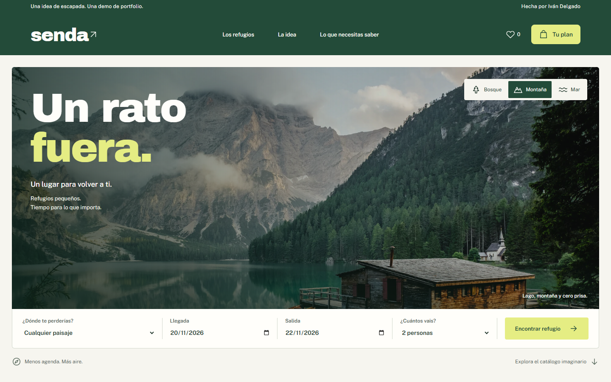

# Senda — Un rato fuera

Una web de escapadas con un planificador interactivo, creada desde cero como tercer proyecto de portfolio de Iván Delgado Galvan. El catálogo, las ubicaciones, la disponibilidad y los precios son ficticios. No se realizan reservas ni pagos.



## Abrir la demo

La opción más sencilla es abrir **exports/Senda-OpenDesign.html** en Chrome, con doble clic. Contiene el diseño, las fuentes, las fotos y el código en un solo archivo; no necesita instalar dependencias. El almacenamiento local depende de las preferencias del navegador.

Para desarrollar la versión modular necesitas Node.js 22 o superior:

```powershell
npm.cmd ci
npm.cmd start
```

Abre **http://127.0.0.1:4328**. En Linux/macOS utiliza npm en lugar de npm.cmd. El servidor escucha únicamente en el equipo local.

## Qué demuestra

- Dirección visual propia: fotografía de naturaleza, tipografía Archivo Black, colores pino y lima, composición editorial y adaptación a móvil.
- Cambio de paisaje que actualiza la imagen principal y el catálogo.
- Seis refugios; filtros combinados por entorno, huéspedes, mascotas, tarifa base y fechas; ordenación por precio.
- Favoritos y último plan guardados localmente, con recuperación ante datos corruptos y mensajes honestos si no se puede guardar.
- Presupuesto detallado: noches, suplemento de viernes/sábado, descuento desde tres noches, limpieza, desayunos y ruta guiada.
- Validación de capacidad, fechas pasadas, orden de fechas, máximo de 14 noches y calendario ficticio.
- Descarga del itinerario en texto y de un evento de calendario .ics, siempre identificado como demo.
- Diálogos nativos, navegación por teclado, foco visible, modo de movimiento reducido y eliminación de los datos de esta demo.
- Sin rastreadores, dependencias de navegador externas, cuentas, formularios de datos personales ni servicios de pago.

## Herramientas de diseño utilizadas

**Impeccable 4.9.2** de [pbakaus/impeccable](https://github.com/pbakaus/impeccable) se instaló localmente en .agents/skills/impeccable. Se ha utilizado para contexto, exploración de dirección, criterios de acabado, detector, revisión independiente y documentación del sistema. La elección de tema y composición la hizo el agente por delegación del usuario; no se presenta como un diseño aprobado previamente por un cliente. El repositorio conserva el sistema visual y la procedencia; la instalación local de la herramienta se excluye del código publicado. Para reutilizar la herramienta, sigue su instalación oficial en el commit indicado en docs/design-sources/provenance.json.

De [OpenDesign](https://open-design.ai/es/) se han consultado y adaptado las guías Bold y Editorial del [repositorio oficial](https://github.com/nexu-io/open-design): jerarquía tipográfica, retícula, espaciado y estados. El resultado usa composición y paleta propias. El HTML autónomo sirve como archivo de trabajo/referencia; no se ha probado una importación en la aplicación ni se ha utilizado una sesión de OpenDesign Cloud.

Los commits de referencia y licencias están en docs/design-sources/.

## Ejecutar las comprobaciones

```powershell
npm.cmd test
npm.cmd run test:browser
npm.cmd run build
npm.cmd run export:opendesign
```

Los tests de navegador utilizan Chrome instalado. Para CI sin Chrome local, instala Chromium con `npx playwright install chromium` y define CI=1. El servidor de pruebas se inicia automáticamente si el puerto está libre.

- tests/unit: reglas de negocio, importes en céntimos, calendario, sanitización y exportación.
- tests/browser: recorridos completos, persistencia, descargas, errores, teclado y axe.
- evidence/: resultados de la última validación.
- docs/screenshots/: capturas listas para revisar.
- PRODUCT.md: objetivo y límites.
- DESIGN.md y .impeccable/design.json: sistema visual extraído de la implementación.
- .impeccable/surfaces/home.md: decisiones de dirección.
- docs/PORTFOLIO.txt: ficha comercial en español e inglés.

## Estructura

```text
public/
  index.html          Página y estructura accesible
  styles.css          Identidad y composición responsive
  js/catalog.js       Seis alojamientos ficticios
  js/domain.js        Fechas, filtros, presupuestos y exportaciones
  js/storage.js       Persistencia acotada y recuperable
  js/app.js           Interacciones
  assets/             Imágenes, fuentes e icono locales
tools/                Servidor, exportación, capturas y empaquetado
tests/                Pruebas de lógica y navegador
docs/                 Fuentes, licencias y material para portfolio
```

## Datos, medios y límites

Las fotografías son imágenes de ambiente de Unsplash, no fotografías de alojamientos reales que se puedan reservar con estos nombres. Sus URLs, licencia y hashes están en docs/asset-provenance.json y en los archivos de procedencia junto a cada WebP. Las fuentes Archivo Black y Public Sans conservan sus licencias SIL Open Font License.

La disponibilidad usa dos noches bloqueadas por refugio, calculadas respecto al día actual; solo sirve para demostrar el comportamiento. Los precios son ejemplos en euros y no constituyen ofertas comerciales. Un calendario real, inventario, administración, pagos, impuestos y confirmaciones necesitarían backend e integración con el proveedor.

El código está disponible en el repositorio público [ivaaandeelgado/freelance-senda-retreat-demo](https://github.com/ivaaandeelgado/freelance-senda-retreat-demo). No se ha activado un alojamiento web ni se ha conectado a un proveedor real de reservas. Descarga el repositorio o el archivo exports/Senda-OpenDesign.html para abrir la demo localmente.

